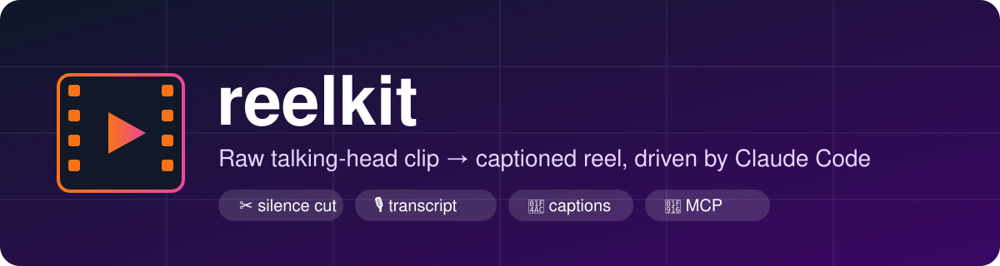
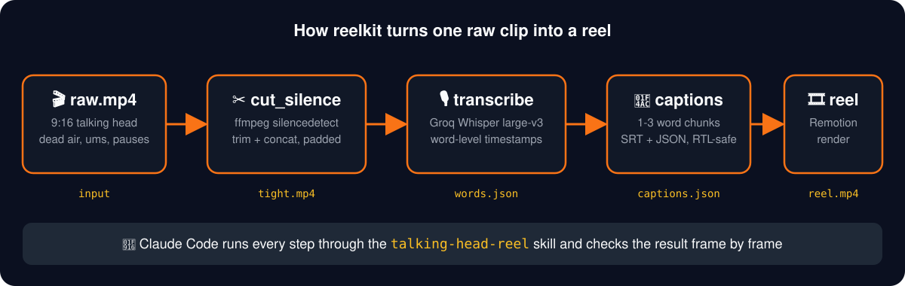

<p align="center"></p>

<p align="center">
  
  
  
  
</p>

# 🎬 reelkit

**Small, dependency-free tools plus a Claude Code skill that turn a raw talking-head clip into a captioned short-form reel.**

## 💡 Why this exists
Editing a talking-head reel is 80% repetitive work: cutting dead air, getting an accurate transcript, timing captions word by word. The remaining 20% (hook, visuals, taste) is where a human or an AI agent adds value. reelkit automates the first 80% with three small scripts and gives Claude Code a skill that chains them, so the agent spends its effort on the creative part.

I build this as a solo creator-developer. I run a marketing agency ([tterr-agency-v2.vercel.app](https://tterr-agency-v2.vercel.app/)), build Google Ads and Facebook Ads landing pages for clients, and edit video for content. reelkit is the part of my workflow I decided to open-source.

## 🗺️ Pipeline
<p align="center"></p>

| Step | Script | Input → Output | What happens |
|---|---|---|---|
| ✂️ 1 | `scripts/cut_silence.py` | `raw.mp4` → `tight.mp4` | ffmpeg `silencedetect` finds pauses, keeps speech with a small pad, joins the pieces |
| 🎙️ 2 | `scripts/transcribe.py` | `tight.mp4` → `words.json` | Extracts 16 kHz mono audio, calls Groq Whisper large-v3, stores each word with start/end time |
| 💬 3 | `scripts/captions.py` | `words.json` → `captions.srt/json` | Groups words into 1-3 word chunks, breaking on punctuation or pauses over 0.4 s |
| 🎞️ 4 | Remotion (your template) | `captions.json` → `reel.mp4` | Renders captions and visuals on top of the tight clip |

Transcribing the **tightened** clip, not the raw one, keeps caption timings in sync with the final video.

## 🧰 What's inside
```
reelkit/
├── scripts/
│   ├── cut_silence.py      ✂️ dead-air remover
│   ├── transcribe.py       🎙️ Groq Whisper word timestamps
│   └── captions.py         💬 caption chunker (SRT + JSON, RTL-safe)
├── skills/
│   └── talking-head-reel/  🤖 Claude Code skill
├── docs/
│   ├── REVERSE_ENGINEERING.md   🔬 learn any editing style from a reference video
│   ├── MCP.md                   🔌 connect MCP servers to Claude Code
│   ├── banner.svg, pipeline.svg
└── LICENSE (MIT)
```

## ✅ Requirements
- Python 3.9+ (standard library only, no `pip install`)
- `ffmpeg` and `ffprobe` on your PATH
- `GROQ_API_KEY` in your environment (only for transcription)

## 🚀 Quick start
```bash
# 1. remove dead air
python scripts/cut_silence.py raw.mp4 -o tight.mp4

# 2. transcribe (Arabic, Darija, English, French all work)
export GROQ_API_KEY=your_key        # PowerShell: $env:GROQ_API_KEY="your_key"
python scripts/transcribe.py tight.mp4 -o words.json --lang ar

# 3. build captions
python scripts/captions.py words.json --max-words 3
```

Example `captions.json`:
```json
[
  { "text": "hello world,", "start": 0.0,  "end": 0.7 },
  { "text": "this is a",    "start": 0.8,  "end": 1.3 },
  { "text": "test",         "start": 1.35, "end": 1.7 }
]
```

## 🤖 Use it as a Claude Code skill
1. Copy `skills/talking-head-reel` into `~/.claude/skills/`.
2. In Claude Code say: *"Edit raw.mp4 into a reel."*
3. Claude runs the pipeline, plans one visual per spoken idea, builds the composition, and checks frames at each cut.

The skill enforces the editing rules I use on client work: edit the **whole** clip (never a demo), use real footage and real images, open on the speaker within 2-3 seconds, keep captions inside the Reels safe zone, and never invent logos or numbers.

## 📚 Guides
- 🔬 **[Reverse-engineer any video edit](docs/REVERSE_ENGINEERING.md)**: a 9-step method to turn a reference reel into measured numbers, a style bible and a reusable skill.
- 🔌 **[Using MCP servers](docs/MCP.md)**: add, authenticate and use MCP servers (including hex-level file tools) with Claude Code.

## 🧪 Design principles
| Principle | Why |
|---|---|
| 🪶 No dependencies | Runs anywhere Python and ffmpeg run; nothing to break |
| 🔑 Keys from env only | Safe to publish, nothing secret in the repo |
| 🌍 RTL-friendly | Arabic punctuation and word order are handled in chunking |
| 🧩 Small, composable scripts | Each step is useful on its own and easy for an agent to call |

## 🗓️ Roadmap
- [ ] Remotion caption template with a highlighted payload word
- [ ] Reels safe-zone checker
- [ ] Batch mode for whole folders
- [ ] Loudness normalisation step
- [ ] Unit tests with a tiny fixture clip

## 🤝 Contributing
Issues and pull requests are welcome, especially new caption styles, language fixes and edge cases for the silence cutter.

## 📄 License
MIT © Yassir Ennajem
